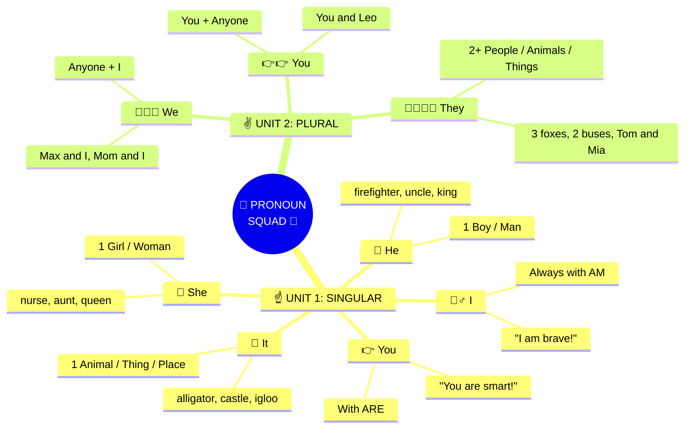

<div align="center">


# 🎪🎢 AHA! GRAMMAR CARNIVAL: GRADE 3 🎢🎪


<p>
  
  
  
</p>

</div>

---

<br>

# 🗺️ PHẦN 1: KHO TỪ VỰNG SIÊU TO KHỔNG LỒ (Chapter 1 Review)

> 💡 **BÍ KÍP VÀNG CHO BÉ:** Nhìn kỹ các nhóm từ vựng dưới đây để làm bài tập phía dưới nhé!

<div align="center">

| 🧑‍🚒 1. PEOPLE & JOBS (Nghề nghiệp) | 🦁 2. WILD ANIMALS (Động vật) | 🏫 3. COOL PLACES (Địa điểm) | 🎒 4. EVERYDAY THINGS (Đồ vật) |
| :---: | :---: | :---: | :---: |
| 👩‍⚕️ **a doctor**<br>👨‍🚒 **a firefighter**<br>👩‍🍳 **a chef**<br>👮‍♂️ **a police officer**<br>🧙‍♂️ **a wizard**<br>👸 **a princess**<br>🧑‍🚀 **an astronaut**<br>👶 **a baby ➔ babies** | 🐘 **an elephant**<br>🐙 **an octopus**<br>🐊 **an alligator**<br>🦅 **an ostrich**<br>🦊 **a fox ➔ foxes**<br>🐺 **a wolf ➔ wolves**<br>🦌 **a deer ➔ deer**<br>🦋 **a butterfly ➔ butterflies** | 🏥 **a hospital**<br>🚒 **a fire station**<br>🏰 **a castle**<br>🏝️ **an island**<br>🧊 **an igloo**<br>🎡 **a theme park**<br>🏖️ **a beach ➔ beaches**<br>📚 **a library ➔ libraries** | ☂️ **an umbrella**<br>⌚ **a watch ➔ watches**<br>🪥 **a toothbrush ➔ toothbrushes**<br>📦 **a box ➔ boxes**<br>🍓 **a strawberry ➔ strawberries**<br>🍃 **a leaf ➔ leaves**<br>🔪 **a knife ➔ knives**<br>🚌 **a bus ➔ buses** |

</div>

<br>

---

<br>

# 🌟 PHẦN 2: BIỆT ĐỘI ĐẠI TỪ NHÂN XƯNG (Chapter 2: Unit 1 & Unit 2)



<br>

### 💬 BẢNG MẪU CÂU ĐẠI DẠNG (Level Up Sentence Patterns)

```diff
+ [I]      -> I am an astronaut. 🚀  | I can ride a bike. 🚲  | I have a skateboard. 🛹
+ [YOU]    -> You are my friend! 🤝  | You like strawberries. 🍓 | You have a magic wand. 🪄
+ [HE]     -> He is a firefighter. 👨‍🚒 | He plays soccer daily. ⚽ | He has a red helmet. ⛑️
+ [SHE]    -> She is a famous chef. 👩‍🍳 | She makes yummy pizzas! 🍕 | She has two white hats. 👒
+ [IT]     -> It is a purple octopus. 🐙 | It swims in the sea. 🌊 | It has eight long legs! 🦵
+ [WE]     -> We are happy campers! ⛺ | We love marshmallows. 🔥 | We have a yellow tent. 🎪
+ [THEY]   -> They are hungry wolves. 🐺 | They run in the forest. 🌲 | They have sharp teeth! 🦷
```

<br>

---

<br>

# 🎪 PHẦN 3: KHU TRÒ CHƠI GIẢI TRÍ (Carnival Game Zone)

---

## 🎈 GAME 1: BONG BÓN NỔ TUNG! (Pop the Balloons)
> 📌 **Cách chơi:** Đọc câu hỏi, suy nghĩ đáp án, sau đó **BẤM VÀO TỪNG HỘP** bên dưới để làm bong bóng nổ ra và xem kết quả!

<details>
<summary>🎈 <b>[Bong bóng số 1]</b> Look at the sky! That is <code>(a / an)</code> eagle. <code>(He / It / They)</code> has huge wings!</summary>

```diff
+ 💥 BỤP! NỔ BONG BÓNG RỒI!
- Đáp án: an eagle ➔ It has huge wings! 
* Giải thích: 1 con đại bàng (động vật) dùng "It". Chữ eagle bắt đầu bằng 'e' dùng "an".
```
</details>

<details>
<summary>🎈 <b>[Bong bóng số 2]</b> Miss Lily is <code>(a / an)</code> art teacher. <code>(He / She / We)</code> paints rainbows!</summary>

```diff
+ 💥 BỤP! NỔ BONG BÓNG RỒI!
- Đáp án: an art teacher ➔ She paints rainbows!
* Giải thích: Cô giáo là nữ (1 người) dùng "She". Chữ art bắt đầu bằng 'a' dùng "an".
```
</details>

<details>
<summary>🎈 <b>[Bong bóng số 3]</b> Watch out! Four <code>(wolf / wolves)</code> are howling! <code>(It / We / They)</code> are hungry!</summary>

```diff
+ 💥 BỤP! NỔ BONG BÓNG RỒI!
- Đáp án: wolves ➔ They are hungry!
* Giải thích: Có 4 con sói (số nhiều, đổi f thành ves) nên dùng "They".
```
</details>

<details>
<summary>🎈 <b>[Bong bóng số 4]</b> My brother and I are in the kitchen. <code>(They / We / You)</code> are baking <code>(a / an)</code> cake!</summary>

```diff
+ 💥 BỤP! NỔ BONG BÓNG RỒI!
- Đáp án: We are baking a chocolate cake!
* Giải thích: Có "I" (My brother + I) thì biến thành "We".
```
</details>

<br>

---

## 🏴‍☠️ GAME 2: RƯƠNG BÁU HẢI TẶC (Pirate Treasure Chests)
> 📌 **Cách chơi:** Đọc 3 gợi ý bí mật, đoán tên Danh từ và Đại từ tương ứng để mở khóa rương vàng!

| 📦 Rương báu | 🕵️‍♂️ 3 Gợi ý bí mật | 🔓 Mở khóa xem đáp án! |
| :---: | :--- | :--- |
| **Rương #1**<br>🔒🪙 | 1. We are sweet red fruits with tiny seeds.<br>2. Change `-y` to `-ies` when there are many!<br>3. Pronoun for **"five strawberries"**? | <details><summary>🗝️ <b>Mở Rương #1</b></summary>🍓 **Strawberries!**<br>🌟 Đại từ: **They** (*They are sweet!*)</details> |
| **Rương #2**<br>🔒💎 | 1. I wear a white suit and fly a rocket to the Moon.<br>2. My job starts with letter **A** (use **`an`**!).<br>3. Pronoun for Captain Dan (1 man)? | <details><summary>🗝️ <b>Mở Rương #2</b></summary>🧑‍🚀 **An astronaut!**<br>🌟 Đại từ: **He** (*He is in space!*)</details> |
| **Rương #3**<br>🔒👑 | 1. I am a cold house made of snow and ice blocks.<br>2. My name starts with letter **I** (use **`an`**!).<br>3. Pronoun for 1 place/thing? | <details><summary>🗝️ <b>Mở Rương #3</b></summary>🧊 **An igloo!**<br>🌟 Đại từ: **It** (*It is very cold!*)</details> |

<br>

---

## 🧪 GAME 3: PHÒNG THÍ NGHIỆM ĐIÊN RỒ (Mad Scientist Lab)
> 📌 **Cách chơi:** Trộn các nguyên liệu lại với nhau trong vạc thuốc xem hiện tượng gì sẽ phát nổ!

* 🧪 **Bình thuốc 1:** 👧 `The princess` + 🐸 `a green frog` + *(best friends)* = ❓
  <details>
  <summary>💥 <b>Uống thử bình 1!</b></summary>

  ```diff
  + 🎆 BOOM! KẾT QUẢ: They are best friends!
  * Vì: 1 người + 1 động vật = 2 sinh thể ➔ Dùng "They".
  ```
  </details>

* 🧪 **Bình thuốc 2:** 👨‍🍳 `My dad` + 🙋‍♂️ `I` + *(cook delicious noodles)* = ❓
  <details>
  <summary>💥 <b>Uống thử bình 2!</b></summary>

  ```diff
  + 🎆 BOOM! KẾT QUẢ: We cook delicious noodles!
  * Vì: Bố + Tôi (Có I) ➔ Dùng "We".
  ```
  </details>

* 🧪 **Bình thuốc 3:** 📦 `One heavy box` ➔ 🪄 *Nhân lên 4 cái!* + *(on the truck)* = ❓
  <details>
  <summary>💥 <b>Uống thử bình 3!</b></summary>

  ```diff
  + 🎆 BOOM! KẾT QUẢ: Four heavy boxes! They are on the truck!
  * Vì: Đổi box thành boxes (-es), thay bằng đại từ They.
  ```
  </details>

<br>

---

## 🍔 GAME 4: QUÁN ĂN QUÁI VẬT (Feed the Monster!)
> 📌 **Cách chơi:** Mỗi quái vật chỉ ăn một loại đại từ nhất định. Hãy tìm ra **1 MÓN ĂN BỊ LẠC** làm quái vật bị đau bụng!

* **1. 🔵 Quái vật "HE" ăn:** `a king` 🍔 | `my grandpa` 🍕 | `an actress` 🌭 | `a waiter` 🍟
  <details>
  <summary>🤮 <b>Món nào làm quái vật HE đau bụng?</b></summary>

  ```diff
  - ĐÁP ÁN: an actress!
  * Vì: Nữ diễn viên là con gái ➔ Phải cho quái vật SHE ăn!
  ```
  </details>

* **2. 🟢 Quái vật "IT" ăn:** `an alligator` 🥩 | `a yellow bus` 🌮 | `two butterflies` 🍦 | `a hospital` 🍩
  <details>
  <summary>🤮 <b>Món nào làm quái vật IT đau bụng?</b></summary>

  ```diff
  - ĐÁP ÁN: two butterflies!
  * Vì: Có 2 con bướm (số nhiều) ➔ Phải cho quái vật THEY ăn!
  ```
  </details>

<br>

---

## 🐉 GAME 5: ĐẤU TRƯỜNG BOSS — TIÊU DIỆT RỒNG NGỮ PHÁP! (Final Boss)
> ⚔️ **Nhiệm vụ:** Rồng Ngữ Pháp đã tạo ra **4 lỗi sai** trong các câu dưới đây. Sửa đúng mỗi câu để trừ **-25 HP** của Rồng và giành chiến thắng!

```text
🐉 DRAGON HP: [████████████████████] 100 / 100 HP
```

* ⚔️ **Đòn đánh 1 (-25 HP):** *"My aunt is **a** honest doctor. **He** works at a big hospital."*
  <details>
  <summary>💥 <b>Vung kiếm sửa lỗi số 1!</b></summary>

  ```diff
  + CRITICAL HIT! (-25 HP)
  * Câu đúng: My aunt is an honest doctor. She works at a big hospital!
  * (Rồng HP: 75 / 100)
  ```
  </details>

* ⚔️ **Đòn đánh 2 (-25 HP):** *"Look at those three red **bus**! **It** are waiting at the station."*
  <details>
  <summary>💥 <b>Bắn cung sửa lỗi số 2!</b></summary>

  ```diff
  + CRITICAL HIT! (-25 HP)
  * Câu đúng: Look at those three red buses! They are waiting at the station!
  * (Rồng HP: 50 / 100)
  ```
  </details>

* ⚔️ **Đòn đánh 3 (-25 HP):** *"Leo and I are in the garden. **They** are catching colorful **butterflys**."*
  <details>
  <summary>💥 <b>Phóng cầu lửa sửa lỗi số 3!</b></summary>

  ```diff
  + CRITICAL HIT! (-25 HP)
  * Câu đúng: Leo and I are in the garden. We are catching colorful butterflies!
  * (Rồng HP: 25 / 100)
  ```
  </details>

* ⚔️ **Đòn đánh 4 (-25 HP):** *"Here is **a** octopus. **She** has eight long arms!"*
  <details>
  <summary>💥 <b>TẤN CÔNG CHÍ MẠNG TIÊU DIỆT BOSS!</b></summary>

  ```diff
  + K.O.! BOSS DEFEATED! (-25 HP -> 0 HP)
  * Câu đúng: Here is an octopus. It has eight long arms!
  ```
  <div align="center">
    
    
    <h3>🏆 CHÚNG MỪNG BÉ ĐÃ TIÊU DIỆT RỒNG NGỮ PHÁP! 🏆</h3>
  </div>
  </details>

<br>

---

<br>

# 🏅 PHẦN 4: BẢNG VINH DANH & NHẬN HUY HIỆU

<div align="center">

| 🎈 1 - 10 Điểm | 🚀 11 - 20 Điểm | 👑 21 - 26 Điểm |
| :---: | :---: | :---: |
| <br>**Carnival Explorer**<br>*Khởi đầu tốt lắm! Chơi tiếp nào!* | <br>**Pronoun Hero**<br>*Siêu quá! Bé nắm rất chắc ngữ pháp!* | <br>**Grand Grammar Champion**<br>*ĐỈNH CAO! Bé đã hạ gục Rồng!* |

<br>


<b>Bấm nút ⭐ STAR ở góc trên bên phải trang GitHub để lưu lại chiến tích nhé!</b>


</div>
